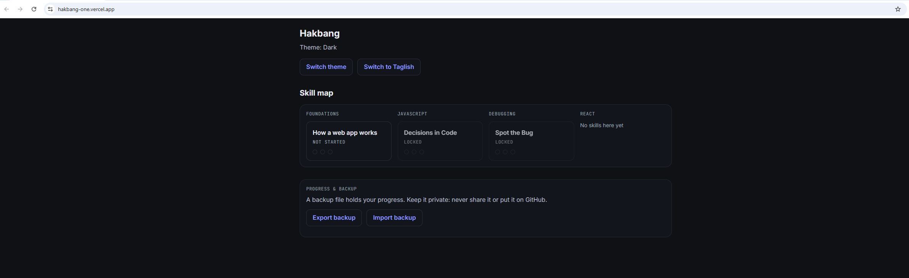

# Hakbang by IAth

A visual, self-paced web app that teaches the skills junior AI-assisted developer jobs ask for. Lessons are short and picture-first, in English and Taglish (Tagalog + English).

**Live app: https://hakbang-one.vercel.app/**



## What it does

- **Skill map** with three mastery levels per skill: Understands, Builds with AI, Debugs and explains alone.
- **Lessons**: a picture, a plain explanation, then one small task.
- **Code tracer**: step through a short function line by line and watch what the computer remembers. You predict first, then step.
- **Guided exercise**: fill in a blank, with three hints that unlock in order. Hints used are recorded.
- **Independent check**: three questions with no hints. The score is saved.
- **Find the bug**: tap the buggy line.
- **Saved progress** in the browser, with Export / Import of a JSON backup.
- One English / Taglish switch for the whole app, and light and dark themes.

## Run it locally

You need Node.js 22 or newer.

```
npm install
npm run dev
```

Other commands:

| Command | What it does |
| --- | --- |
| `npm test` | Runs the Vitest tests |
| `npm run lint` | Checks the code style |
| `npm run build` | Type-checks and builds the app into `dist/` |

GitHub Actions runs lint, tests and build on every push to `main`.

## How lessons are checked

A lesson is one JSON file in `content/lessons/`. The format is described in [docs/lesson-schema.md](docs/lesson-schema.md).

Before a lesson is shown, `validateLesson` in `src/lib/lesson.ts` checks it. Every piece of text must exist in both languages, an answer must match one of its options, a bug line must be inside the code, and so on. A broken file is rejected, and the app shows which field is wrong instead of crashing.

## Your progress and backups

Progress is saved in your browser's `localStorage`, which is separate for every address. Progress made on `localhost` will not appear on the live site, and the other way round. To move it, use **Export backup** on one and **Import backup** on the other. Backup files (`hakbang-progress-*.json`) are personal data and are ignored by git.

## Built with two AIs

This project is built by one person together with two AI assistants, each with its own folder:

| Folder | Owner |
| --- | --- |
| `src/` and config files | Claude Code |
| `content/lessons/`, `docs/diagrams/` | Gemini |

The shared rules live in [CLAUDE.md](CLAUDE.md), [GEMINI.md](GEMINI.md) and `docs/`. The owner runs every git, test, build and deploy command by hand, so each step is learned and not just generated.

## Stack

React 19, TypeScript (strict), Vite, Tailwind CSS 4, Vitest. Deployed on Vercel. No backend, no login, no database.

## What I learned

<!-- Ian writes this part himself: 3 to 5 lines, in his own words. -->

_Coming soon._

## License

[MIT](LICENSE)
